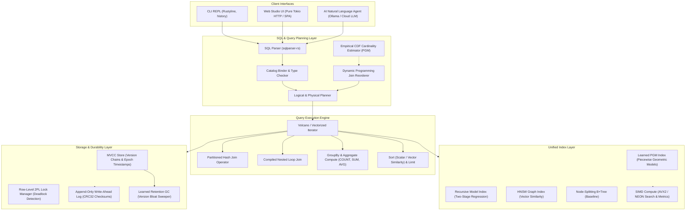
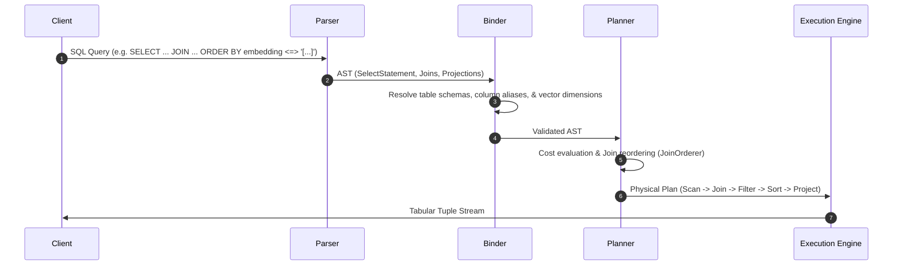
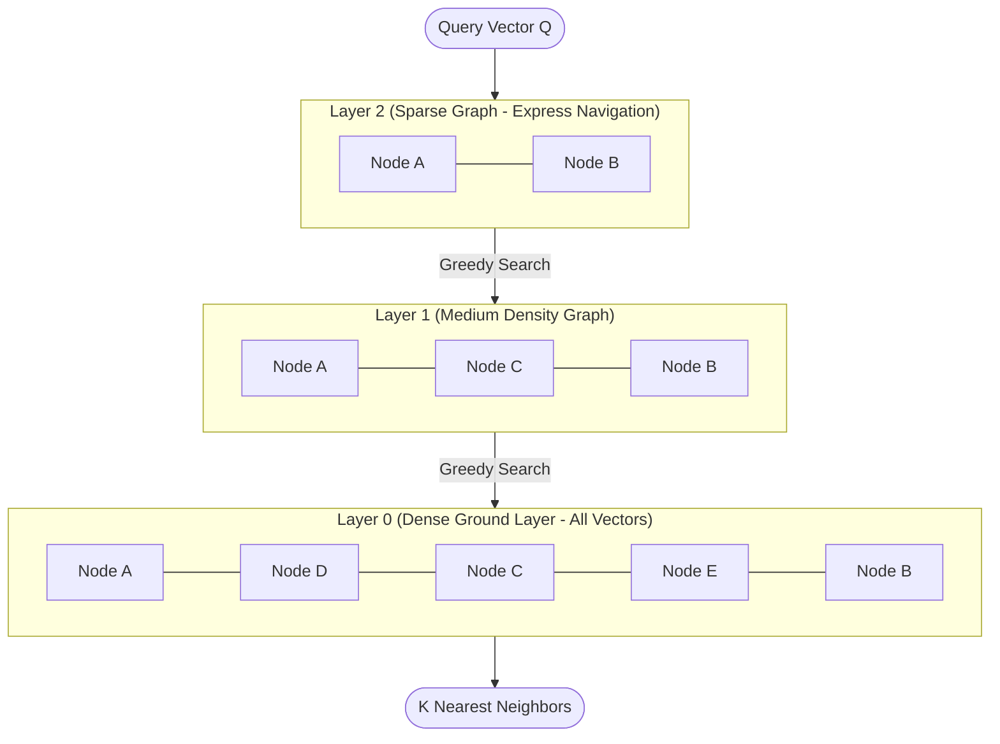
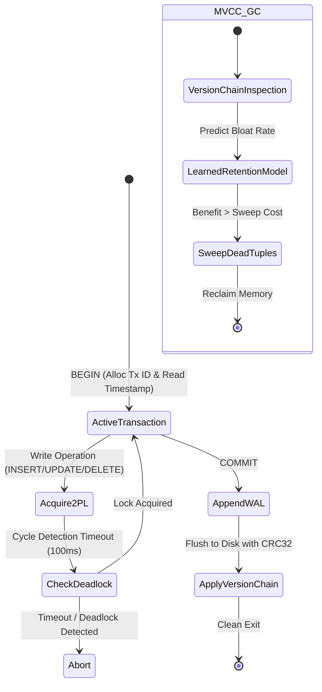

# ShrestiDB Architecture & System Design

This document details the internal architecture, engine layers, storage mechanisms, and algorithmic workflows powering **ShrestiDB**.

---

## 1. System Overview

ShrestiDB is an embedded, unified database engine that combines:
1. **Classical Relational Execution** (ANSI SQL, multi-table hash joins, MVCC transactions, ACID durability).
2. **Learned Machine Learning Indexes** (Piecewise Geometric Models & Recursive Model Indexes).
3. **High-Dimensional Vector Search** (HNSW proximity graph with SIMD distance kernels).
4. **Self-Contained Management & AI** (Embedded Tokio async HTTP Web Studio and local AI agent).

---

## 2. Layer Deep Dives

### 2.1 SQL & Optimization Layer

* **Parser & Binder**: Wraps standard SQL AST. Resolves table aliases (`accounts a`), multi-column aliases (`z.zip_code AS address_zip_code`), and unqualified identifiers across join schemas.
* **Learned Cardinality Estimator**: During `ANALYZE <table>`, builds an empirical Cumulative Distribution Function (CDF) by fitting a PGM model over sorted column keys, avoiding inaccurate static 50% selectivity assumptions.
* **Dynamic Programming Join Reordering**: Uses PGM cardinality estimates to determine the optimal equi-join order, placing small build tables on the left of hash partitions.

---

### 2.2 Learned Index Architecture (PGM & RMI)

Traditional B-Trees incur $O(\log N)$ branch mispredictions across tree nodes. ShrestiDB models index lookup as a numeric regression problem:

$$f(\text{key}) \to \text{physical record position}$$

* **Piecewise Geometric Model (PGM)**: Partitions sorted keys into optimal linear segments with bounded error $\epsilon$. Because segments store only slope and intercept $(m, c)$, index size is reduced by **~4x** compared to a node-splitting B+Tree.
* **Dynamic PGM**: Pairs a frozen, optimal PGM base with an append-only write buffer, amortizing bulk-load rebuilds geometrically.
* **Performance**: With $S$ segments where $S \ll N$, lookup complexity is $O(\log S) + O(\log \epsilon)$, achieving sub-microsecond point queries on million-row tables.

---

### 2.3 Vector Database Engine (HNSW & SIMD)

For high-dimensional embeddings (`VECTOR(N)`), ShrestiDB incorporates a multi-layer **Hierarchical Navigable Small World (HNSW)** graph index:

* **Distance Metrics**:
  - `<=>` **Cosine Distance**: $1 - \frac{\vec{u} \cdot \vec{v}}{\|\vec{u}\| \|\vec{v}\|}$ (semantic and text search)
  - `<->` **L2 Euclidean Distance**: $\|\vec{u} - \vec{v}\|_2$ (spatial and geometric search)
  - `<#>` **Negative Dot Product**: $-\vec{u} \cdot \vec{v}$ (normalized unit embeddings)
* **Hardware SIMD**: Evaluates dot products and Euclidean norms using portable 8-wide f32 SIMD vector registers (AVX2 / NEON).

---

### 2.4 Transactional Storage & MVCC Lifecycle

* **Snapshot Isolation (MVCC)**: Queries read row versions visible as of their `BEGIN` transaction timestamp. Read transactions execute lock-free.
* **Row-Level 2PL**: Exclusive write locks guard mutated records with a 100ms cycle-detection timeout to prevent deadlocks.
* **Crash Recovery (WAL)**: All table operations log binary records to disk before acknowledgment. On boot, the replay engine rebuilds catalogs, indexes, and row tables deterministically.
* **Learned Retention GC**: An online linear model predicts version churn, triggering row-chain compaction when reclaimable space exceeds sweep overhead, eliminating manual `VACUUM`.
